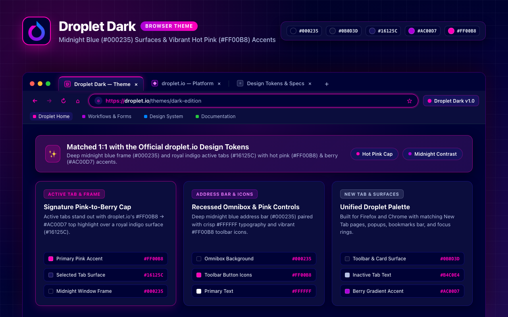
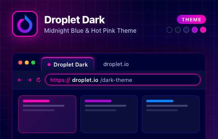
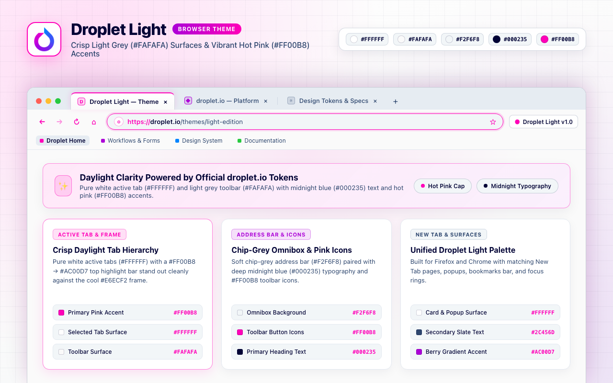
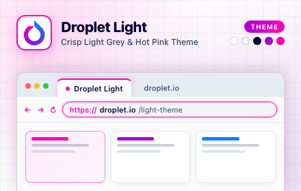

# Droplet — Dark & Light Themes for Firefox & Chrome

Midnight blue (`#000235`) and crisp light grey (`#fafafa` / `#f2f6f8` / `#ffffff`) browser themes with signature hot pink (`#ff00b8`) and berry (`#ac00d7`) accents matched 1:1 with **[droplet.io](https://droplet.io/)**.

Includes both **Dark** and **Light** editions across:
- **Firefox WebExtension Themes** (`firefox-addon/`, `firefox-addon-light/`)
- **Chrome WebExtension Themes** (`chrome-addon/`, `chrome-addon-light/`)

---

## Previews

| Edition | Store Screenshot (`1280×800`) | Small Promo Tile (`440×280`) |
| :--- | :--- | :--- |
| **Droplet Dark** |  |  |
| **Droplet Light** |  |  |

---

## Color Palette (Matched to `droplet.io` CSS Tokens)

| Token (`droplet.io`) | Dark Value | Light Value | Usage |
| :--- | :--- | :--- | :--- |
| `--magenta` (`#ff00b8`) | `#ff00b8` | `#ff00b8` | Primary pink accent: toolbar icons, active tab line, focus rings, links, text selection |
| `--berry` (`#ac00d7`) | `#ac00d7` | `#ac00d7` | Secondary pink-berry gradient cap & attention states |
| `--midnight-blue` (`#000235`) | `#000235` | `#000235` | Dark window frame, omnibox & NTP backdrop / Light primary heading & tab text |
| `--light-grey` (`#fafafa`) | `#0b0d3d` | `#fafafa` | Toolbar & surface backdrop |
| `--chip--bg-grey` (`#f2f6f8`) | `#000235` | `#f2f6f8` | Omnibox / URL bar input field background |
| **Selected Tab** | `#16125c` | `#ffffff` | Active tab surface |
| **Secondary Text** | `#b4c0e4` | `#2c456d` | Inactive tab text & secondary labels (`p { color: #2c456d }` on `droplet.io`) |

---

## Building

```bash
npm run build
```

Outputs separate **Dark** and **Light** packages for Firefox and Chrome in `build/`:

- **Firefox Add-ons**:
  - `build/droplet-firefox-theme-dark.xpi` & `build/droplet-firefox-theme-dark.zip`
  - `build/droplet-firefox-theme-light.xpi` & `build/droplet-firefox-theme-light.zip`
- **Chrome Web Store Themes**:
  - `build/droplet-chrome-theme-dark.zip`
  - `build/droplet-chrome-theme-light.zip`

---

## Installation

### Firefox
1. Run `npm run build`.
2. Open `about:debugging#/runtime/this-firefox`, click **Load Temporary Add-on...**, and select `build/droplet-firefox-theme-dark.xpi` or `build/droplet-firefox-theme-light.xpi`.

### Chrome
1. Run `npm run build`.
2. Open `chrome://extensions`, enable **Developer mode**, click **Load unpacked**, and select `chrome-addon/` (Dark) or `chrome-addon-light/` (Light).

---

## License

[All Rights Reserved](LICENSE) © 2026 Droplet Inc.
